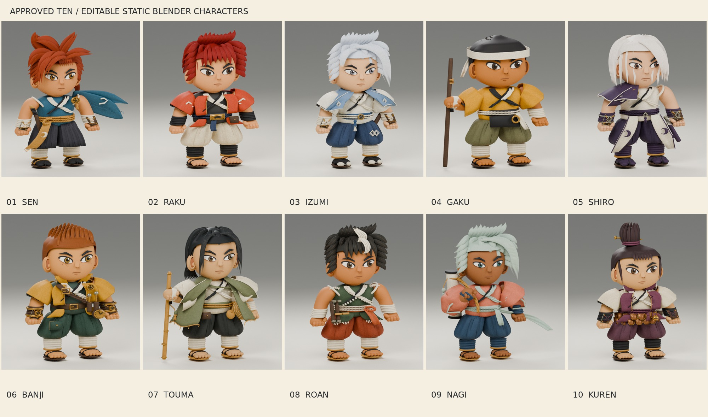

# Approved ten — static Blender character models

Sen · Raku · Izumi · Gaku · Shiro · Banji · Touma · Roan · Nagi · Kuren

Editable static 3D interpretations of the ten approved concept drawings in [references](references/). Each source contains separate named hair, face, clothing, wraps, footwear, and equipment, a placement root, packed materials and its original reference image. The GLBs contain real three-dimensional geometry and embedded materials; the studio, camera and reference image are excluded from exports.

## Files

- [Complete model archive](releases/approved-ten-blender-models.zip): ten `.blend` sources, ten `.glb` exports, comparison and turnaround boards, this guide, and validation reports.
- [Blender sources](blend/) — authored and reopened with Blender 4.3.2.
- [GLB exports](glb/) — separately reimported and checked against the evaluated source geometry.
- [Previews](previews/) — three-quarter, front, side, back, GLB reimport, and reference comparison views.
- [Validation](validation/) — per-character measured geometry and bounds checks.
- [Exact approved references](references/) — unchanged original PNG bytes, with SHA-256 manifest.

| Character | Distinguishing modeled forms | Source | GLB | Comparison | Turnaround |
|---|---|---|---|---|---|
| Sen | Copper swept hair and low tie; blue scarf; pleated hakama; braided ochre belt; wooden sword | [BLEND](blend/sen.blend) | [GLB](glb/sen.glb) | [View](previews/sen_comparison.jpg) | [View](previews/sen_turnaround.jpg) |
| Raku | Red shag; ember jacket and sleeve marks; dark wraps; cream trousers; metal belt plate and pouch | [BLEND](blend/raku.blend) | [GLB](glb/raku.glb) | [View](previews/raku_comparison.jpg) | [View](previews/raku_turnaround.jpg) |
| Izumi | White swept hair; blue shoulder cape; ivory robe; snow lozenges; belt ornament and dagger | [BLEND](blend/izumi.blend) | [GLB](glb/izumi.glb) | [View](previews/izumi_comparison.jpg) | [View](previews/izumi_turnaround.jpg) |
| Gaku | Close crop and woven headband; ochre robe; olive trousers; raised staff grip; apron and brass ring | [BLEND](blend/gaku.blend) | [GLB](glb/gaku.glb) | [View](previews/gaku_comparison.jpg) | [View](previews/gaku_turnaround.jpg) |
| Shiro | Asymmetric ivory bob; purple shoulder mantle; long split coat panels; moon emblems and sheathed sword | [BLEND](blend/shiro.blend) | [GLB](glb/shiro.glb) | [View](previews/shiro_comparison.jpg) | [View](previews/shiro_turnaround.jpg) |
| Banji | Short brown crest; cropped brass-colored jacket; green shirt/trousers; diagonal harness; tools and pocket clock | [BLEND](blend/banji.blend) | [GLB](glb/banji.glb) | [View](previews/banji_comparison.jpg) | [View](previews/banji_turnaround.jpg) |
| Touma | Long black face locks and low ponytail; moss cloak; travel staff; woven hanging hat and drawstring bag | [BLEND](blend/touma.blend) | [GLB](glb/touma.glb) | [View](previews/touma_comparison.jpg) | [View](previews/touma_turnaround.jpg) |
| Roan | Dark tousled hair and ivory forelock; green shearling-edged vest; rust trousers; paired tonfa | [BLEND](blend/roan.blend) | [GLB](glb/roan.glb) | [View](previews/roan_comparison.jpg) | [View](previews/roan_turnaround.jpg) |
| Nagi | Seafoam side sweep; darker complexion and teal eyes; coral kimono; mint streamer; shoulder rope and scroll case | [BLEND](blend/nagi.blend) | [GLB](glb/nagi.glb) | [View](previews/nagi_comparison.jpg) | [View](previews/nagi_turnaround.jpg) |
| Kuren | Tied topknot and hairpin; plum vest; overlapping copper waist scales; bell, tassels and folded fan | [BLEND](blend/kuren.blend) | [GLB](glb/kuren.glb) | [View](previews/kuren_comparison.jpg) | [View](previews/kuren_turnaround.jpg) |

## Editing

Open an individual source and work in the `Name • editable character` collection. The `Name_Root` empty moves the entire assembled character. The studio collection is separate. Mesh control cages, subdivision modifiers, cloth thickness modifiers, and curve-based braids/trim remain editable in the source. In GLB, curves and modifiers are converted into portable mesh geometry.

Units are metres, Blender Z up, character forward +Y. The root is at ground level between the feet. Character heights include exaggerated concept hair; uniformly rescale the root if your scene needs a different nominal height. These are detailed static assets, not LOD-optimized game characters.

For hand edits, save the `.blend` and export only the character collection to GLB with modifiers applied, animations/cameras/lights disabled. Do not rerun the generation scripts on hand-edited sources: they rebuild geometry. `tools/build_characters.py`, `tools/polish_sources.py`, `tools/repair_hair_shells.py`, `tools/finish_coat_backs.py`, and `tools/final_contacts.py` record the original authoring process; `tools/validate_render.py` reopens and checks the resulting files, and `tools/make_boards.py` assembles the review boards.

## Fidelity and scope

The drawings provide one view per character. Rear hair, back seams, garment interiors and hidden equipment attachment points are interpretations. The models retain the main color identities, broad compact proportions, layered outfits and signature accessories, but simplify painted wear, embroidery, cloth tears, individual hair strands and small hardware. The faces use a shared stylized construction with adjusted proportions; fine facial likeness and the intricate painted hair shapes are less exact than the outfit and accessory identities. Compare each model directly with the supplied drawing in its comparison board.

No skeletons, skin weights, animations, combat logic, collision, or game integration are included. Clothing and equipment are separate overlapping surfaces intended for editing and rendering, not a single watertight fabrication mesh. The packed fiber textures and UVs are simple surface treatments, not a hand-painted production atlas.

## Validation

Every source is reopened from disk. Each GLB is reimported into Blender and checked for finite vertex coordinates, triangle-count agreement, matching world bounds, and ground clearance. Studio and reference elements are excluded from the GLB. Front, side, back and three-quarter views support visual review of silhouettes and contacts. These technical checks do not certify exact artistic likeness or deformation quality.

All work is confined to this asset pack on the separately authorized `feat/hero-concept-models` branch. Prior Goemon assets and the separately developed dog models are untouched.
