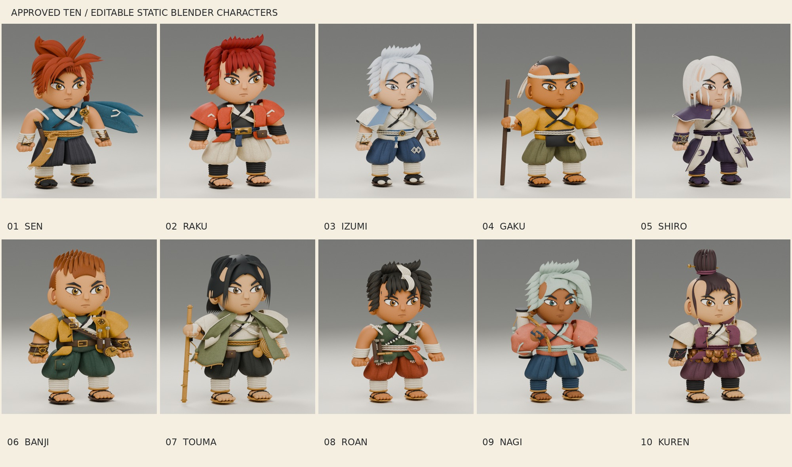

# Historical work-in-progress checkpoint

This page preserves the interim lineup shared during modeling. It is superseded by the [completed static model pack](../README.md) and [current lineup](lineup.jpg).

The final sources include the subsequent scalp, hairline, cloth-back, staff, headband, and framing corrections. All ten final sources were reopened and their GLBs reimported for geometry and bounds checks. See the [validation reports](../validation/).

Earlier work-in-progress lineup

