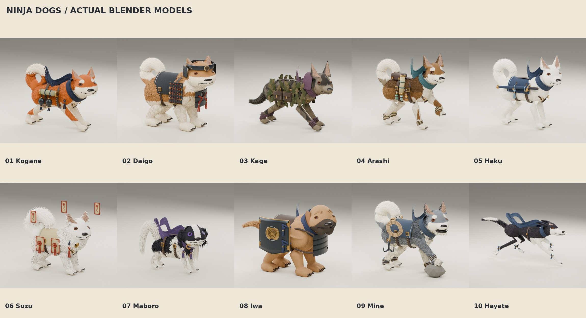

# Ninja dogs — Blender model pack

Ten static Blender sculptures based on the approved original drawings in `references/`. Each model has separately editable anatomy, fur, equipment, and materials. These models are isolated from the game by `.gdignore`.



[Reference comparison: Kogane](previews/01_comparison.jpg) · [All preview sheets](previews/) · [Offline review gallery ZIP](downloads/Review_Gallery.zip?raw=true)

[Online download index](https://github.com/eric2532/Goemon/tree/feat/ninja-dog-models/asset_packs/ninja_dogs) — use this link when reading the README from an individual extracted ZIP.

## Access the models

Use the numbered ZIP links in the completed download table below. Extract a ZIP and open its `.blend` in Blender 4.3.2 or later. The corresponding `.glb` contains the static model and base PBR materials for import into other 3D tools. No add-ons or paid services are required.

## Scope and interpretation

These are static, posed models. They do not have armatures, animations, cloth simulation, combat integration, or production retopology. Canine silhouettes, coat markings and recognizable equipment follow the approved illustrations. Fur is modeled as tapered surface strands rather than individual simulated hairs. Hidden-side construction and equipment backs are inferred from the single concept view. Fine painted wear, every hair strand, embroidered line and illustrated magical effect cannot be represented identically in a static mesh; differences are documented per dog.

The original PNGs remain unchanged, with their reference hashes in `references/manifest.json`. No main-game asset is replaced. The unrelated warrior and Storm Pilgrim prototype packs are excluded from this branch.

## Review and rebuild

`tools/build_dogs.py` creates the anatomy, directional fur, facial surfaces, poses and studio; `tools/gear.py` supplies each dog’s equipment. Sources retain named objects and editable curves. GLB export evaluates curves to mesh so cords and tassels are retained.

The first comparison gate is Kogane. It led to a wider cheek structure, finer fur, a fitted scarf, inset ear coloring, surface-projected facial details, a fuller curled tail, and explicit toes/claws. Review sheets include the original reference beside the model, full-body views, and portraits.


| Dog | Editable Blender ZIP | Static GLB ZIP | Drawing/model comparison |
|---|---|---|---|
| 01 Kogane | [Download](downloads/01_Kogane_Blender.zip?raw=true) | [Download](downloads/01_Kogane_GLB.zip?raw=true) | [Preview](previews/01_comparison.jpg) |
| 02 Daigo | [Download](downloads/02_Daigo_Blender.zip?raw=true) | [Download](downloads/02_Daigo_GLB.zip?raw=true) | [Preview](previews/02_comparison.jpg) |
| 03 Kage | [Download](downloads/03_Kage_Blender.zip?raw=true) | [Download](downloads/03_Kage_GLB.zip?raw=true) | [Preview](previews/03_comparison.jpg) |
| 04 Arashi | [Download](downloads/04_Arashi_Blender.zip?raw=true) | [Download](downloads/04_Arashi_GLB.zip?raw=true) | [Preview](previews/04_comparison.jpg) |
| 05 Haku | [Download](downloads/05_Haku_Blender.zip?raw=true) | [Download](downloads/05_Haku_GLB.zip?raw=true) | [Preview](previews/05_comparison.jpg) |
| 06 Suzu | [Download](downloads/06_Suzu_Blender.zip?raw=true) | [Download](downloads/06_Suzu_GLB.zip?raw=true) | [Preview](previews/06_comparison.jpg) |
| 07 Maboro | [Download](downloads/07_Maboro_Blender.zip?raw=true) | [Download](downloads/07_Maboro_GLB.zip?raw=true) | [Preview](previews/07_comparison.jpg) |
| 08 Iwa | [Download](downloads/08_Iwa_Blender.zip?raw=true) | [Download](downloads/08_Iwa_GLB.zip?raw=true) | [Preview](previews/08_comparison.jpg) |
| 09 Mine | [Download](downloads/09_Mine_Blender.zip?raw=true) | [Download](downloads/09_Mine_GLB.zip?raw=true) | [Preview](previews/09_comparison.jpg) |
| 10 Hayate | [Download](downloads/10_Hayate_Blender.zip?raw=true) | [Download](downloads/10_Hayate_GLB.zip?raw=true) | [Preview](previews/10_comparison.jpg) |

[Combined Blender collection — 64.8 MB](Ninja_Dogs_Collection.blend?raw=true) contains ten collection assets with preview thumbnails. Only Kogane is visible initially; enable one numbered collection at a time in the Outliner, or use Current File in Blender’s Asset Browser. All image textures are packed.

Unzip the review gallery and open `gallery/index.html`. Its ten selection buttons, previous/next buttons and view selector work offline. GitHub displays HTML source rather than running the gallery.

## Verification and limitations

`asset_manifest.json` lists source/export paths, triangle counts, bounds and hashes. `validation.json` records all ten source reopen and GLB reimport checks, finite mesh coordinates, packed image dependencies, matching world bounds, geometry uniqueness and hashes. `library_validation.json` records the combined library reopen, asset-thumbnail checks, and per-dog geometry bounds/object-count comparisons against the individual sources. `gallery_test.json` records browser navigation, image loading and mobile layout checks. `archive_manifest.json` records ZIP sizes, SHA256 hashes and CRC tests; each ZIP is below 15 MB (largest: 11.7 MB).

`visual_review.json` records the visual review and remaining interpretation differences. These meshes are sculptural assets with dense modeled fur; they are **not optimized, rigged, animation-ready game characters**. There are no idle/run/attack tests because no animations are supplied. Fine surface intersections within fur and layered equipment may require cleanup during future retopology and rigging. The original concept’s painterly detail and expressions are not reproduced exactly.

## Rebuilding

The delivered `.blend` files are the authoritative editable results. The tools retain the modeling and refinement history. From this directory, the construction sequence is `blender -b --python-exit-code 1 --python tools/build_dogs.py`, followed by the face, plume, grooming and detail refinement scripts, textile generation, and `finish_assets.py`. The final saved-source corrections are `fix_suzu_ward.py`, `fix_chin_locks.py`, and `fix_iwa_support.py`. Refinement scripts that shift or add geometry should only run once on freshly built sources. Rendering, validation and presentation can be rerun independently:

```sh
blender -b --python-exit-code 1 --python tools/render_models.py
blender -b --python-exit-code 1 --python tools/validate.py
python tools/boards.py
python tools/gallery.py
python tools/test_gallery.py
blender -b --python-exit-code 1 --python tools/library.py
blender -b --python-exit-code 1 --python tools/check_library_geometry.py
python tools/manifest.py
python tools/package.py
python tools/verify_delivery.py
```

No game scene, main menu, combat settings, or existing character is replaced. This branch adds only the ninja-dog pack. Private GitHub downloads require repository access.
