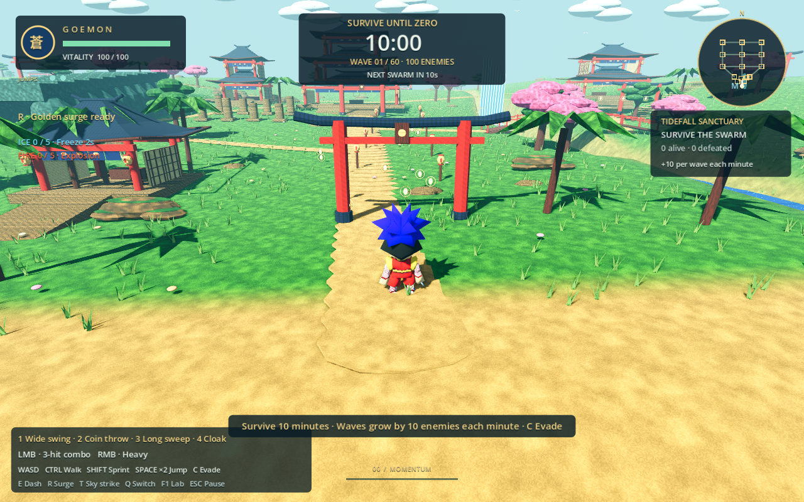
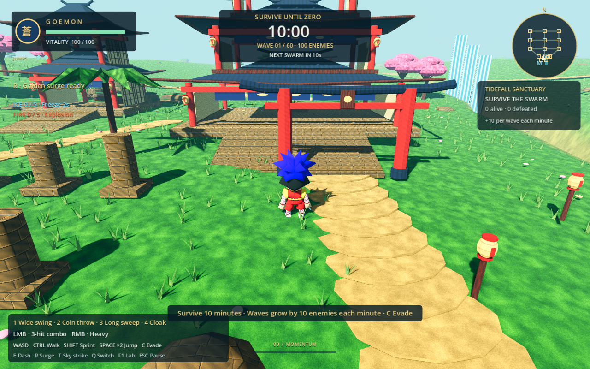
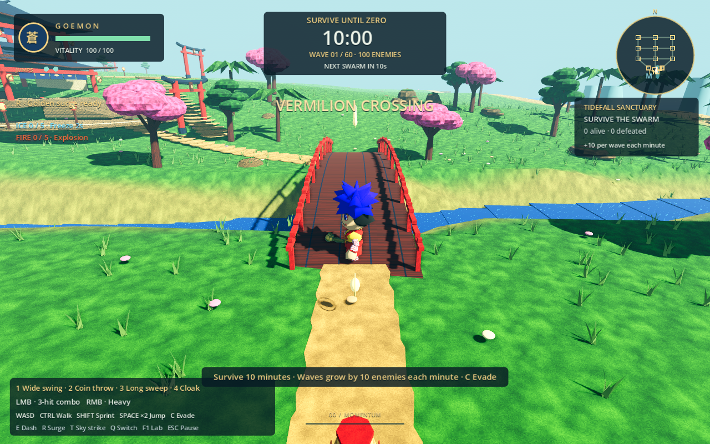
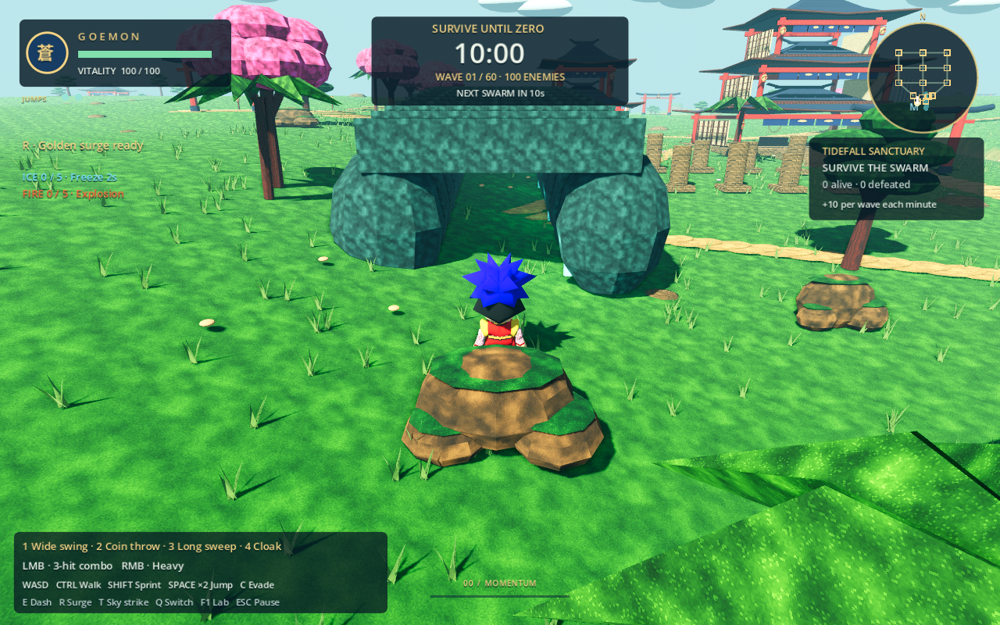
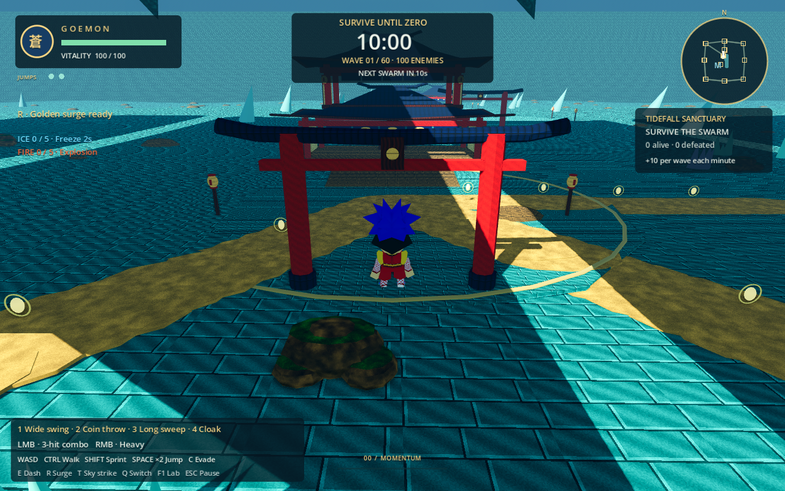
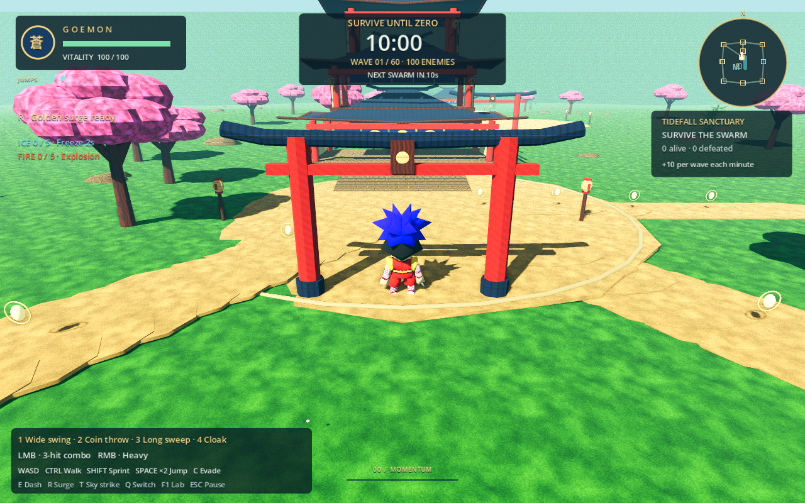
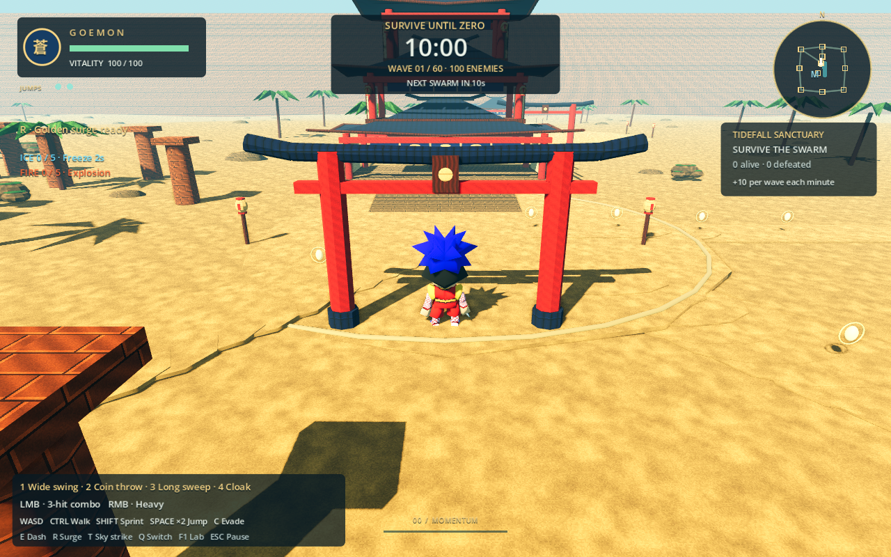
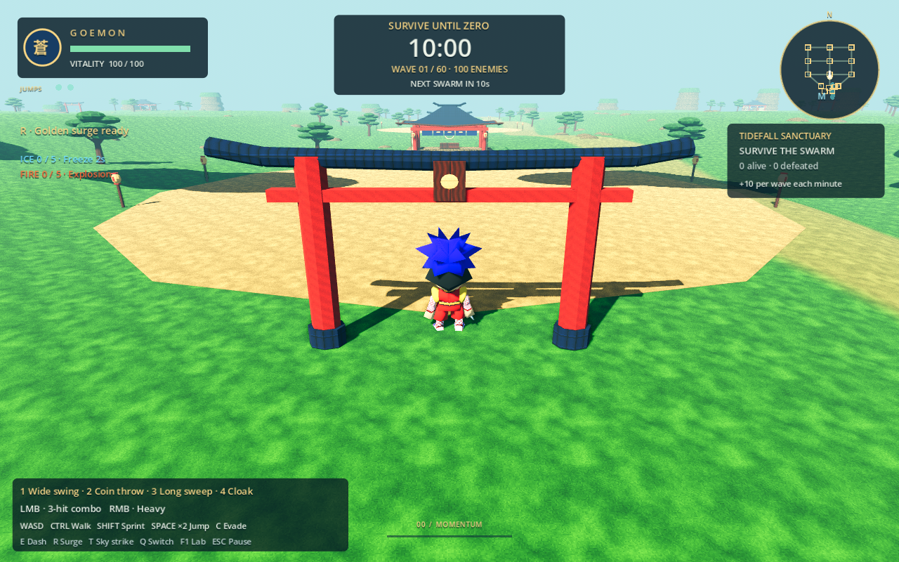

# Colorful Edo environment reskin

Original Blender-authored environment art inspired by the first 3D Nintendo 64 Mystical Ninja's painted timber, cream shoji, indigo ceramic roofs, vermilion gates, bright grass and pink blossom. No Nintendo textures or meshes are included.

The active Tidefall Sanctuary and all three dormant region generators share the new kit. Survival still exposes only Tidefall; this change does not enable travel or change the map layout. Existing courts, paths, buildings, ramps, bridge segments, tunnels, boundaries and all 36 outer outposts retain their established positions and collision.

## Editable assets

`assets/blender/edo/` contains 13 independent editable `.blend` files, matched by `assets/models/edo/*.glb`:

- `roof`, `torii`, `shoji`, `noren`, `lantern`: tiled eaves, timber/plaster architecture, blue overhead curtains and paper lamps.
- `bridge_deck`, `grotto_bay`: visual skins over the original bridge and cave collision meshes.
- `green_tree`, `cherry_tree`, `palm`, `bamboo`: pine-like layered foliage, blossoms, coastal palms and highland bamboo.
- `moss_rock`, `grass_tuft`: painted rocks and the existing 3,400-instance grass field.

Sixteen original 128×128 diffuse textures in `assets/textures/edo/` cover timber, plaster, tile, grass, sand, foliage, paper, lacquer, stone and cave rock. Texture patterns are authored in Blender's Python/image workflow and packed into the sources and exports. Materials are matte. Existing world lighting and all character/effect/UI materials remain unchanged.

Edit a saved source in Blender and export it with the existing workflow:

```sh
blender --background assets/blender/edo/roof.blend --python tools/export_blender.py
```

`tools/build_edo_environment.py` documents the original construction. It refuses to overwrite an existing kit unless explicitly passed `--replace`; normal art edits should use the saved sources. It never invokes the legacy all-assets generator. Existing character sources, including Musashi's approved master, are untouched.

## Coverage and integration

| Region | Environment treatment |
| --- | --- |
| Tidefall Sanctuary | Grassy banks, sand shore/path surfaces, blue water, tiled shrines, wood bridge, paper lamps, pines/cherries/palms, rock grotto, exterior escarpments and nine outposts |
| Jade Grotto (dormant) | Jade court tiling, textured cavern walls/ceiling and tunnels, indigo shrine roofs, warm lanterns and nine outposts; existing crystals remain readable |
| Sakura Highlands (dormant) | Pink cherry and bamboo vegetation, grassy landscape, warm paths, shoji shrines and nine outposts |
| Sunforge Citadel (dormant) | Sandy terrain, ochre masonry, coastal palms, vermilion/indigo architecture and nine outposts |

`EdoEnvironment` owns environment-only texture materials, without modifying `Geo`'s cached actor/effect materials. Terrain retains its original vertices and collision; the new shader provides diffuse ground surfaces. Original roof, bridge and cave collision owners remain in place, hidden only visually. Added GLB visuals contain no physics bodies or navigation regions. Shoji panels dress existing solid wall faces; noren curtains hang above the open entrances. Vegetation uses existing placements and random draws. No gameplay, camera, player, enemy, UI or navigation code changes are made.

## Gameplay-camera review

Captures use the actual `ActionCamera` (63° FOV, 14 m follow distance and normal collision probes), with actors held still for inspection. Dormant-region captures are test-only previews; their survival HUD is intentionally unchanged. All 14 camera positions were reviewed. Selected captures are stored beside this document.










## Visual reference

The reference screenshots informed palette, painted surfaces and broad architecture, rather than a reconstruction of the original level layout:

- [Oedo street](https://djcube.co.uk/wp-content/uploads/2023/10/goemon-002.jpg)
- [Countryside](https://djcube.co.uk/wp-content/uploads/2023/10/goemon-003.jpg)
- [Castle enclosure](https://djcube.co.uk/wp-content/uploads/2023/10/goemon-004.jpg)
- [Castle interior](https://djcube.co.uk/wp-content/uploads/2023/10/goemon-005.jpg)

See [validation](../../tests/environment-reskin/VALIDATION.md) for checks and renderer limitations.
