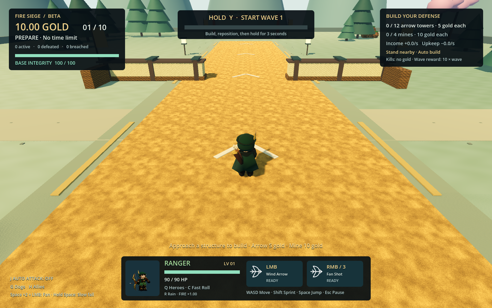
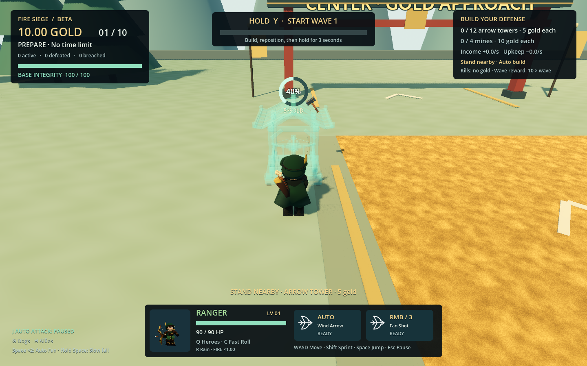
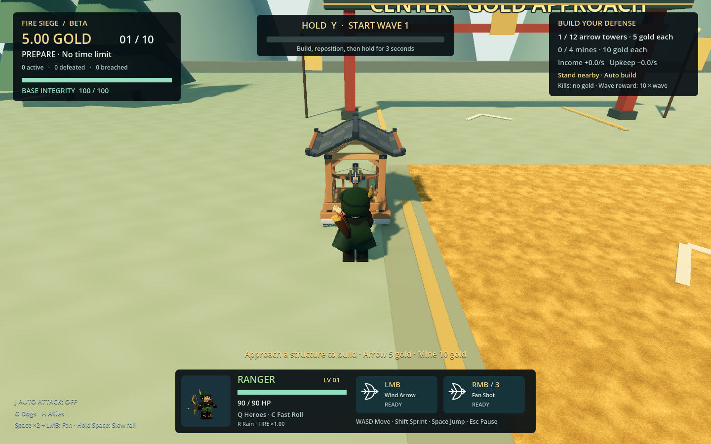

# Fire Siege v2.45 · GitHub review handoff

The latest game source is on **`codex/fire-siege-mvp`** in [eric2532/Goemon](https://github.com/eric2532/Goemon/tree/codex/fire-siege-mvp). This is the primary Fire Siege development branch. The initial v2.45 publication contains all updates since v2.37: Ranger appearance and arrow mechanics, the in-game map builder, J auto attack and automatic construction. Main and the historical Sky Descent application are separate.

## Get and run this version

```sh
git clone --branch codex/fire-siege-mvp --single-branch https://github.com/eric2532/Goemon.git
cd Goemon
godot --headless --editor --path . --quit
godot --path . -- --tower-defense
```

Use Godot 4.6.1 and allow assets to import on a fresh checkout. Choose Fire Siege/Beta or Hard and a hero. The macOS build preset is **Fire Siege macOS**, version 2.45.0; the preset named macOS exports the older application. Generated builds, caches and local maps are excluded from Git. All required runtime models/textures, editable Ranger Blender source, generators and test scripts are committed.

## Review the behavior

- Ranger arrows fly straight after release with small random horizontal/vertical launch angles. Every third primary is a green power shot, combos accelerate fire, Rain powers all arrows, and double-jump firing produces a downward five-arrow fan. Both jumps are twice as high; held airborne Space slows descent to roughly one third. C rolls quickly in camera-relative movement direction. The fitted hat covers his head.
- J toggles normal auto attack for all twelve heroes. Native timing and manual charging remain. Construction, menus and evasive actions suspend it; new runs, death, changing heroes and entering the editor turn it off.
- Stand stationary near an affordable tower/mine spot to build automatically. No B input is required. Move away, jump or roll to stop work; return to resume. A tower costs five gold/three seconds; a mine costs ten gold/four seconds. Payment happens once on completion.
- Empty spots use small muted stones. Nearby structures appear as a full translucent preview. A circular ring starts at twelve o'clock and fills counterclockwise. Completion restores the solid model and hides the ring.
- Build Your Own Map offers scenery/ground/gameplay pieces, ordered routes, edit/history/save/load and Play Map. Custom play shares the latest combat and construction rules.

## Verification

Run the existing acceptance runner and the feature suites:

```sh
python3 tools/verify_fire_siege.py
godot --headless --path . --fixed-fps 60 -- --auto-build-test
godot --headless --path . --fixed-fps 60 -- --auto-attack-test
godot --headless --path . --fixed-fps 60 -- --ranger-air-test
godot --headless --path . --fixed-fps 60 -- --map-builder-test
godot --headless --path . --fixed-fps 60 -- --rogue-equipment-combat-test
godot --headless --path . --script res://scripts/map_document_tests.gd
godot --path . -- --auto-build-tour
```

Fresh publication checks passed every gameplay assertion and exited zero individually. **The strict acceptance runner exits 1 because the controls suite reports 15 resources still in use at Godot shutdown, although all 136 controls assertions pass.** Equipment also emits a shutdown resource warning. These cleanup diagnostics are retained in [verification.json](review-v245/verification.json); do not interpret the strict runner as entirely green. The previously exported v2.45 package passed all 660 assertions, including the rendered construction tour. No gameplay/script/parse failure was observed.

The following screenshots come from that actual exported v2.45 application:






