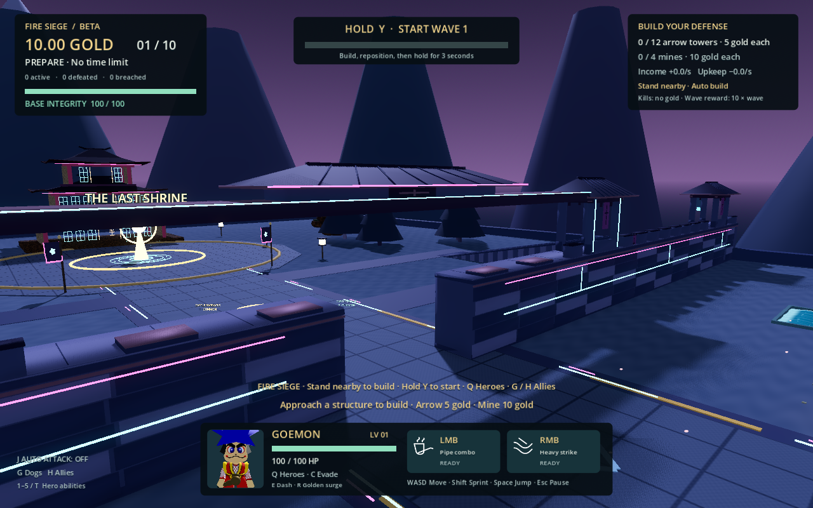
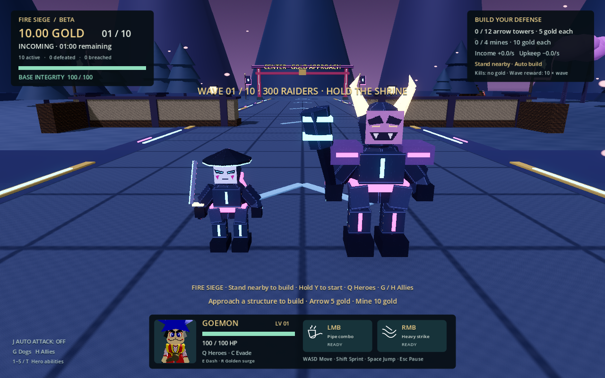

# Neon shrine dusk · Fire Siege v2.47.0

The standard Fire Siege battlefield combines Japanese gates, tiered shrine
eaves, cherry trees and lanterns with dark indigo stone and cyan/magenta circuits.
The collision layout, tower and mine sites, route, controls and 300-actor wave
limit stay intact. The two new enemy types appear in both standard and custom
sieges; custom map scenery keeps its authored layout and existing palette.

## Enemy roster

Every ten arrivals includes eight existing raiders, one cyber ronin and one
armored oni, so each complete wave contains 30 of each new type.

| Type | HP | March speed | Combat role |
| --- | ---: | ---: | --- |
| Cyber ronin | 80 | 13.225 m/s | Fast melee attacker; existing bandit dash timing, 0.8× damage |
| Armored oni | 180 | 5.74 m/s | Heavy melee attacker; existing bruiser windup, 1.4× damage |

Oni armor describes its silhouette and higher health; it does not silently
introduce directional immunity. All types use the existing hit, freeze,
knockback, tower targeting, breach and death-accounting paths. They add no
per-actor lights, particles, skeletons or material instances.

Original assets are generated with `tools/draw_neon_enemy_atlas.py` (Pillow) and
`tools/build_neon_enemies.py` (Blender). Sources are editable `.blend` files under
`assets/blender/enemies/neon_set`; matching GLBs are under
`assets/models/enemies/neon_set`. The painted 256px atlas is separate from the
approved original enemy and hero artwork. See `asset-catalog.json` for geometry
counts. Named limbs feed the existing GPU crowd shader; the additional opaque
batches add two species to the original four.

## Effects and quality

The default map uses Godot's ACES tonemapping, ambient/sun lighting, emission
glow and distance fog. Opaque emissive rails, gate seals and shrine lattices
are combined into three MultiMesh batches with shadows disabled. The map's
material remapping duplicates environment materials locally and preserves
shared hero/effect resources. The existing Spirit Fortress water, animated
cloth, petals and motes retain their pause, restart and quality controls.

Low quality keeps the dark palette and visible circuit geometry, while turning
off bloom, SSAO, shadows and added Spirit Fortress effects. Medium enables
glow/SSAO and existing particles; High adds the existing shrine accent shadow
and higher MSAA. No extra shadowed lights or screen-copy/refraction passes are
introduced. The map editor keeps its authoring lighting.

## Validation

`scripts/neon_shrine_tests.gd` drives the real spawner through all 300 actors,
checks both new types' health/speed/render selection and death accounting, and
checks decoration collision/shadow/Low quality behavior and mode isolation.
`scripts/neon_shrine_captures.gd` renders the actual world and crowd models from
front, profile and back for visual inspection. Performance comparison uses
`scripts/spirit_fortress_performance.gd` with the same window, camera, quality,
VSync and 300 active actors for v2.46.1 and v2.47.0.

See [measured performance and limitations](performance.md).

`scripts/neon_emission_tests.gd` renders the actual enemy shader and atlas in an
unlit scene. Cyan, magenta and amber swatches must emit; ordinary dark armor must
remain black. This caught and corrected the Blender-to-glTF V-coordinate flip.

Final verification: all 14 source acceptance suites passed. The exported PCK
passed the 13-check neon roster suite, 27-check Spirit Fortress suite and
four-check rendered emission test; the native app passed its 14-check automatic
construction suite. The original enemy renderer passed after replacing obsolete
exact-four-batch assumptions with preservation checks and verifying that the
siege-only species stay unused in survival. The app reports Godot 4.6.3, version
2.47.0, and contains both arm64 and x86_64 executables; strict/deep code-signature
verification passed. The native headless test retains the previously recorded
single DummyShader RID shutdown diagnostic. Native UI opening was blocked by
the locked Mac; the seven rendered gameplay views and exported emission test
were inspected separately.
