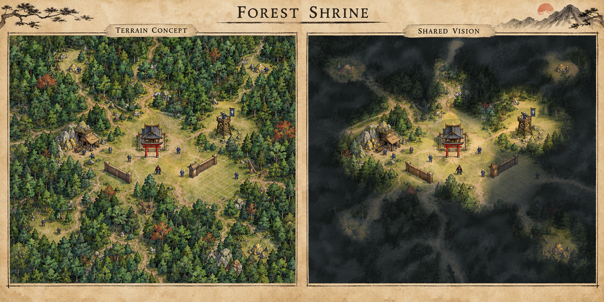

# Forest Shrine Siege Design

Date: 2026-10-13

Status: Design draft for review. Gameplay direction is agreed; proposed prototype defaults below remain adjustable. Implementation is outside this documentation pass.

## Player experience

Build an economy and defenses around a single shrine in the middle of a forest. Explore to discover gold and reveal approaching enemies. Before each wave, arrange the settlement from an overhead view of the actual 3D battlefield. During the wave, fight as the hero and redirect existing workers through one hold-and-release command.

Success means that preparation creates meaningful choices, workers remain useful without repeated instructions, and combat never requires a construction or workforce management menu. The player can understand why a worker chose a job and why an enemy became visible.

## Agreed design

| Area | Decision |
| --- | --- |
| Preparation | Before every wave, using an overhead camera on the actual 3D battlefield and a hand-drawn interface. |
| Construction | Free placement on a grid for mines, towers, walls, and gates. |
| Combat | Live hero combat; no new construction during waves and no tactical pause for worker commands. Work with the units and structures already on the field. |
| Worker command | Hold a button to gather workers inside a generous circle around the hero. They follow while held. Release near useful work to assign them. |
| Worker jobs | Gather and deliver mine gold, repair walls, or shoot arrows from large towers. |
| Job selection | Choose the closest available job, without a mine-first or defense-first priority. |
| Worker safety | Retreat automatically from danger. Wounded workers are unavailable for the rest of the wave and recover during preparation. |
| Gates and walls | Hero and workers can pass through gates. Enemies can attack walls that block their advance. |
| Battlefield | One central shrine surrounded by a large forest. Enemies can approach from randomly chosen directions around the map. |
| Exploration | Terrain and gold deposits begin unexplored. Explored terrain remains remembered for the run. |
| Vision | Hero, healthy workers, and buildings contribute shared vision. Enemies are visible only inside current vision. |
| Art | New forest and settlement art direction, with illustrated interface elements over the live 3D world. |

## Proposed prototype boundary

The remaining rules make the first version concrete without treating unreviewed details as user decisions. They are proposed defaults throughout the following sections.

Introduce Forest Shrine as a separate selectable siege prototype using the existing Rogue Siege combat view and hero controls. Build one authored forest layout with randomized attack directions. Retain the existing modes as references. The initial construction set is mine, worker-crewed watchtower, wall, and gate; the shrine is already present.

Use gold as the only spendable resource. Tree harvesting, procedural terrain generation, new hero kits, technology trees, and additional ally recruitment systems are outside this first prototype. Existing card drafts and character changes must not interrupt a wave; any retained choices belong in preparation.

## Preparation and wave transitions

The world instance remains loaded throughout the run. Preparation changes the camera and input context rather than replacing the battlefield with a separate map. Grid footprints, terrain, gates, buildings, and paths therefore occupy the same positions in both views.

Preparation is untimed. Enemy movement, worker movement, mining, attacks, and repair timers are stopped. The player can pan and zoom the overhead camera, place and remove buildings, buy repairs, recruit workers at the shrine, and set initial worker assignments. Worker assignments are queued for the next wave; the preparation interface does not move units to scout through frozen time.

Construction completes immediately in preparation. There is no worker building job in this prototype. New buildings provide vision immediately, but their footprints must already be explored and have an allied ground route from the shrine. This allows expansion into discovered land while preventing construction into unexplored fog. Never hide a building-placement rejection behind a generic error: show blocked terrain, occupied cells, unexplored land, inaccessible entrance, or insufficient gold.

Start Wave switches to the combat camera and resumes the simulation. New construction, recruitment, upgrades, demolition, and direct purchase of repairs are unavailable during combat. Existing workers can perform their repair job and spend available gold. Money earned during the wave is retained for those repairs and the next preparation phase.

The wave ends only when its finite enemy roster has finished spawning and every member is resolved. Enter preparation, award the wave reward, recover wounded workers at the shrine, and preserve healthy worker positions, building damage, assignments, gold, and explored terrain. Clear the previous wave's damaging projectiles and effects before resuming building controls. The final wave leads to victory; shrine destruction or the existing hero defeat condition ends the run.

## Forest layout and construction

The central clearing must contain the shrine, a starter gold deposit inside its initial vision, room for a small defensive perimeter, and several possible exits. Additional gold deposits sit in separate woodland clearings. Richer outer deposits reward exploration but lengthen worker travel and expose more territory.

The forest surrounds the center on all sides. Traversable gaps and connected clearings permit attacks from every compass sector; the layout is not a set of fixed siege lanes. Trees and rocks shape movement and placement. Keep large enough clearings for different wall layouts, and fade foreground tree canopies when they obscure the hero, workers, or construction previews.

All construction uses square grid footprints, with quarter-turn rotation. Walls can be dragged into straight grid-aligned runs. Gates replace a compatible wall opening and show their passage width before placement. Mines occupy discovered gold deposits; towers can occupy ordinary valid terrain.

Placement must preserve worker access to the shrine, each active mine entrance, and tower entrances. A fully enclosed settlement is valid if allied gates provide those routes. Reject a placement that would trap an allied unit or seal an active workplace. This validation concerns allied access; enemy access can be blocked intentionally.

Friendly gates open automatically for the hero and workers and stay hostile barriers for enemies. Enemy navigation considers open ground routes and destructible barriers. If a wall or gate blocks the chosen advance, the enemy attacks a reachable segment and continues through the breach. It must not freeze because no entirely open route reaches the shrine. Distant forest openings should not make enemies march around the entire perimeter to avoid a nearby breach opportunity.

## Workers and the hold command

The command is a dedicated rebindable action. Holding it displays a ground circle centered on the hero and gathers healthy owned workers whose ground positions enter the circle. Miners, repair workers, idle workers, and tower occupants are eligible. Recalled tower occupants exit through the tower entrance before following. Wounded workers are ineligible.

Selection accumulates during one hold: a gathered worker remains in the group after leaving the circle. New workers can join as the hero moves. The group follows using ground paths and gates, keeps personal space, and does not teleport over walls. If the hero jumps or flies, the destination projects onto reachable ground; a ground-unreachable hero cannot drag workers through obstacles.

Show the circle, gathered worker count, and worker highlights while held. Keep normal hero movement available. The command never pauses or slows time and does not open a panel. Ordinary Escape pause remains available; it is not a command interface.

On release, use the hero's ground position as the center of a local work area. Consider jobs within that area, then choose each worker's nearest reachable available job by actual ground travel distance. Reserve each chosen slot before assigning the next worker. Use stable worker ordering and stable tie-breaking so the preview does not flicker between equivalent assignments.

Mine slots, tower archer positions, and repair positions are limited. Available means a free slot, a reachable workplace, and the resources needed for its task. A wall needs damage and affordable repair; a mine needs collectible gold. Unreachable jobs and jobs outside the local area are ignored. Surplus workers wait at a reachable point near the release location with an idle icon; they do not search the whole map.

Assigned workers retain their job rather than repeatedly switching to whatever becomes closer. Show small destination previews during the hold, such as two workers to a tower and one to a wall. Recompute on release if a job became unavailable. Workers that have not reached the release area yet still receive reservations and travel toward their jobs.

## Jobs and economic behavior

| Job | Behavior | Completion and interruption |
| --- | --- | --- |
| Mine gold | Travel to the mine, collect a load, deliver it to the shrine, and repeat. Only delivery adds gold to the shared treasury. | Depleted deposits make assigned workers idle at the mine. A recall or retreat preserves carried cargo, which must still be delivered before that worker starts a different job. |
| Repair wall | Travel to a repair position, spend gold in small repair increments, and restore the selected wall or gate. | A fully repaired target leaves the worker stationed there, ready to resume after new damage. With no affordable gold, wait with a clear icon. Recall frees the slot. |
| Man tower | Enter a free archer position and shoot at enemies within both tower range and shared current vision. | The worker remains assigned until recalled, evacuated, or wounded. Empty positions contribute no arrows. An empty tower still provides its building vision. |

Every healthy worker can perform every job. Gold stays shared between construction, recruitment, and repairs, so deploying more workers defensively reduces mine income and repairs can consume funds intended for expansion.

Preparation has no passive income. Mining continues during waves only. A fixed wave-clear reward provides a recovery floor even if every worker is wounded. Proposed first-pass enemies grant no direct gold, making worker deliveries central to the economy rather than a minor supplement to mass kills.

## Retreat and recovery

Safety overrides work and following. A worker taking damage or threatened at close range retreats automatically toward a reachable friendly shelter, preferring the shrine and then a surviving tower. Workers do not rejoin the same rally hold repeatedly while danger keeps forcing them out.

Retreat preserves the previous job but releases its occupied slot. After a sustained safe interval, the worker attempts to reclaim that job if reachable and available. If it was taken, destroyed, or depleted, the worker remains idle at safety. An explicit new rally can replace a saved job once retreat danger has passed.

Garrisoned workers are protected while their tower stands. A critically damaged tower triggers evacuation. If damage reduces a worker's health to zero, that worker becomes wounded, stops work, releases reservations, and contributes no vision. The worker cannot be selected, targeted repeatedly, or used to block movement. Cargo held at wounding is lost; uncollected deposit gold remains.

At the next preparation phase, wounded workers recover at the shrine without a replacement purchase. They become available for assignment; recovery does not move them back to distant jobs while time is frozen. A failed run does not enter preparation merely to recover workers.

## Fog and shared vision

| State | Display and interaction |
| --- | --- |
| Unexplored | Conceal terrain, deposits, enemies, and all location-dependent markers. Panning the overhead camera does not reveal them. |
| Explored but not currently visible | Show dimmed remembered terrain and discovered deposit locations. Hide live enemy models, health bars, outlines, markers, and target previews. Do not update remembered information about unseen changes. |
| Currently visible | Show terrain and enemies using the union of all active friendly vision sources. |

Exploration persists for the run and resets on a new run. Current visibility updates as sources move, recover, are wounded, are built, or are destroyed. Buildings contribute vision even when unstaffed, but a tower requires workers to shoot. Walls and gates have only a small local sight radius, preventing cheap distant wall segments from replacing watchtowers.

Hero and worker vision must reveal ground gradually while exploring. Trees and solid terrain interrupt sight; towers see over low obstacles and tree cover within their bounded sight radius. For the first prototype, flight does not expand the hero's sight radius or bypass forest sight blockers. This keeps scouting and tower positions relevant with the existing movement kit.

Friendly defenses acquire enemies only inside shared current vision. Losing visibility clears a live tracking target. A projectile already fired may continue physically, but cannot keep homing using hidden enemy coordinates. Hero area attacks can still hit unseen enemies physically; hidden hits must not create enemy outlines or damage numbers that reveal locations through fog. Hostile projectiles become visible when they enter a visible area, without revealing their unseen source.

The preparation camera, combat view, target indicators, and any map widget use the same visibility state. Remembered terrain is not permission to display hidden enemies. Internal wave completion counts do not grant positional information.

## Enemy waves

Select entry sectors from the full perimeter using the run seed and wave number. Entry locations must be outside current friendly vision and connected to the forest navigation network. Reserve an outer approach belt that is not buildable and remains beyond allied scouting bounds so every allowed expansion leaves valid hidden entry locations. Enemies travel through the forest; they do not appear next to the shrine merely because an interior patch is currently unseen.

Early waves use a single entry sector. Later waves can split across multiple sectors. A wave-start cue announces that the attack has begun without revealing its direction. A first-sighting warning can point only to a currently visible enemy. Repeated unseen contacts must not leak coordinates through directional UI or spatialized attack cues.

Hidden enemies continue moving, attacking reachable structures, and making progress toward the shrine. Scouting provides real warning time. Keep a bounded live enemy population and release pending enemies as slots become available. Retry uses the same terrain and attack seed for repeatable testing; a new run can use a different attack seed.

## Prototype starting values

These are concrete playtest defaults, not established balance results or additional user-approved requirements. All belong in mode configuration.

| Parameter | Proposed value |
| --- | --- |
| Run | Five waves; enemy rosters of 24, 36, 48, 60, and 80; 80 maximum alive. |
| Attack sectors per wave | 1, 1, 2, 2, and 3. |
| Starting workforce and treasury | Six workers and 400 gold. |
| Wave-clear reward | 100 gold. |
| Prices | Mine 150, watchtower 120, worker 50, wall segment 10, gate 30. |
| Mine capacity and delivery | Three workers; 10 gold per load; five seconds collecting plus travel. |
| Deposit reserves | Starter deposit 600 gold; outer deposits 1,200 gold each. |
| Tower staffing | Three archer positions per watchtower. |
| Repair | One gold restores 10 health; one increment per second per repair worker; two repair positions per segment. |
| Recall and local job area | Five grid cells in radius around the hero and the release point respectively. |
| Vision radii before blockers | Shrine eight cells; watchtower ten; mine four; hero six; worker three; wall or gate one. |
| Retreat | Trigger within two grid cells of a threatening enemy or after damage; resume after three safe seconds; evacuate a tower below 20 percent health. |
| First map envelope | 80 by 80 grid cells with a central clearing about 18 cells across; outer twelve-cell approach belt beyond allied access, wider than the maximum ten-cell sight radius. |

Grid cells are the design unit for layout and sight. Their world-space scale is chosen to fit existing hero, gate, and worker collision sizes during implementation planning; the design does not assume the current game's movement scale has already been balanced for this map.

The opening economy deliberately allows one mine and one tower with funds left for a short wall and gate. The first playtest must check whether travel, mining, retreat, and repairs create useful trade-offs; it must not inherit the current Fire Siege mode's 600-enemy waves or 12,000-gold opening by accident.

## Interface and art

Preparation uses the actual 3D world with grid overlays and building ghosts. Add illustrated building icons, ink outlines, parchment panels, restrained brush textures, clear prices, worker counts, and a prominent Start Wave control. Invalid placement stays legible against forest terrain. Avoid heavy parchment treatment over the battlefield itself.

Combat keeps the hero view, small resource and shrine indicators, the live worker circle, and brief order feedback. Job icons and wounded counts communicate status without opening a management screen. Any information that depends on enemy positions obeys current vision.

The art set needs the central shrine and clearing, several cedar/tree silhouettes, forest floor and paths, gold deposits, mine states, wall and gate states, staffed and empty watchtowers, readable workers with job props, wounded/retreat indicators, and fog transitions. Prioritize silhouette and canopy readability over dense foliage. The concept below establishes mood and composition, not exact dimensions, sight radii, or starting structures.

The concept was generated with the built-in image-generation tool during this discussion. Its complete prompt is preserved in [the concept prompt](2026-10-13-forest-shrine-concept-prompt.txt). Its illustrated dark areas are an art treatment; the visibility rules above are authoritative.

## System responsibilities

The existing game uses Godot and separates the siege encounter logic in `scripts/tower_defense.gd`, battlefield construction in `scripts/tower_defense_world.gd`, and mode/input flow in `scripts/game.gd`. The current siege has fixed sites, lane routes, preparation countdowns, and battle-time building controls. This design requires distinct behavior rather than only a camera change.

Use focused components with one shared world state:

| Component | Owns | Depends on |
| --- | --- | --- |
| Forest siege session | Phase transitions, run seed, wave lifecycle, victory and defeat. | World, wave director, economy, and worker recovery. |
| Forest world and build grid | Terrain, deposits, footprints, allied routes, destructible barriers, and entrances. | Building definitions and navigation. |
| Workforce | Rally selection, worker states, cargo, retreat, and recovery. | Navigation, shared vision, economy, and job board. |
| Job board | Reachable local jobs, capacity, reservations, and deterministic assignment. | Workplace state and route distances. |
| Economy | Purchases, deposits, deliveries, repairs, and rewards. | Session phase and valid transactions. |
| Shared vision | Explored cells, visible cells, source lifecycles, and remembered terrain. | World blockers and friendly sources. |
| Wave director | Seeded entry sectors, finite rosters, spawn budgets, and resolved enemies. | Session, navigation, barriers, and sight-safe entry belt. |
| Preparation and combat presentation | Cameras, input routing, grid ghosts, illustrated UI, and visibility-filtered rendering. | Session and the same underlying simulation state. |

Buildings publish jobs and sight sources; they do not each implement their own worker-selection system. Economy transactions validate phase and cost centrally. The renderer and target acquisition consult the same vision service. Reset clears reservations, cargo, wave actors, construction, and fog without carrying state between runs.

## Validation and playtest criteria

Before calling a future implementation complete, demonstrate these behaviors in the running game and cover the state rules with focused automated checks:

1. Place a mine, walls, gate, and tower in preparation. Start a wave and verify identical positions, collision, entrances, and worker routes in combat.
2. Attempt construction, recruitment, demolition, roster changes, and paid direct repairs during combat. None may open a tactical management flow or create new field resources. Worker repair remains functional.
3. Hold the command while moving through miners and tower occupants. Workers join once, leave jobs correctly, navigate the gate, and follow without pausing the fight.
4. Release near a wall and then near a tower. Nearest reachable jobs win, reservations prevent overfilling, and surplus workers stay locally idle. Repeat with blocked routes, no gold, a full tower, and a depleted mine.
5. Damage and wound workers. Retreat overrides jobs; wounded units contribute neither work nor vision; all wounded workers recover only when preparation begins.
6. Explore a deposit, leave, and return. Terrain and deposit location remain remembered while unseen enemies, outlines, bars, markers, and target tracking disappear. Moving the preparation camera reveals nothing by itself.
7. Recall or wound a remote scout and destroy a watchtower. Shared vision shrinks correctly without erasing explored terrain. Restart clears both current vision and exploration.
8. Enclose the shrine with walls and gates. Friendly routes remain usable; enemies attack a blocking barrier and traverse its breach instead of freezing.
9. Play attacks from every perimeter sector, including multiple sectors together. Verify hidden spawning, genuine travel time, no interior surprise spawns, and correct completion with a partially pending roster.
10. Finish a wave with all workers wounded and little gold. The reward and recovery permit another preparation phase. Shrine defeat instead ends the run cleanly.
11. Finish all five prototype waves, retry, and return to existing modes. Confirm phase, camera, input, economy, worker, and fog state do not leak between runs or modes.

Observe whether a player can complete a wave without issuing any worker command after a sensible preparation, and whether repositioning a small crew visibly changes a threatened flank's outcome. Repeated unnecessary orders, unclear job choices, hidden enemy leaks, or a need to build during battle are failures of the intended experience.

## Review focus

The agreed design is captured in the first table. The remaining review concerns the proposed five-wave prototype, starting values, mine delivery behavior, local assignment rules, retreat safeguards, and scope of the first art set. No implementation plan or gameplay changes are included in this pass.
