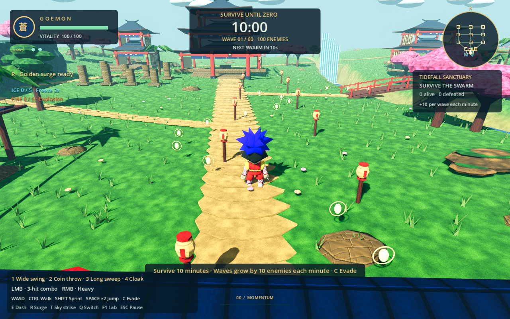
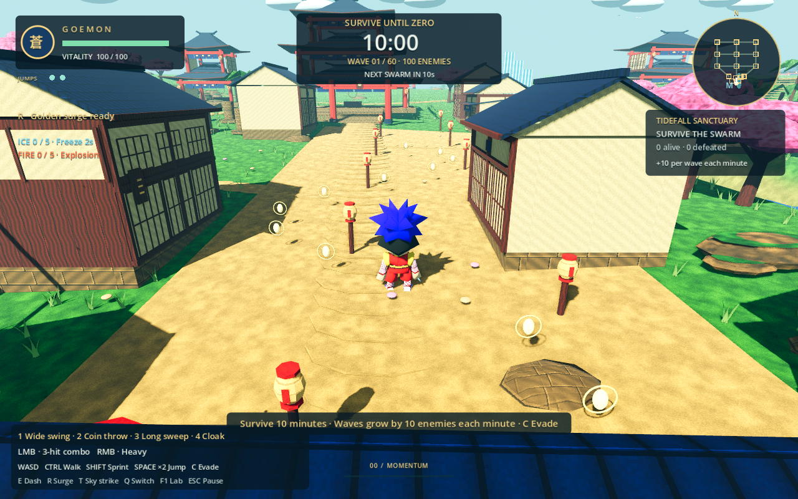
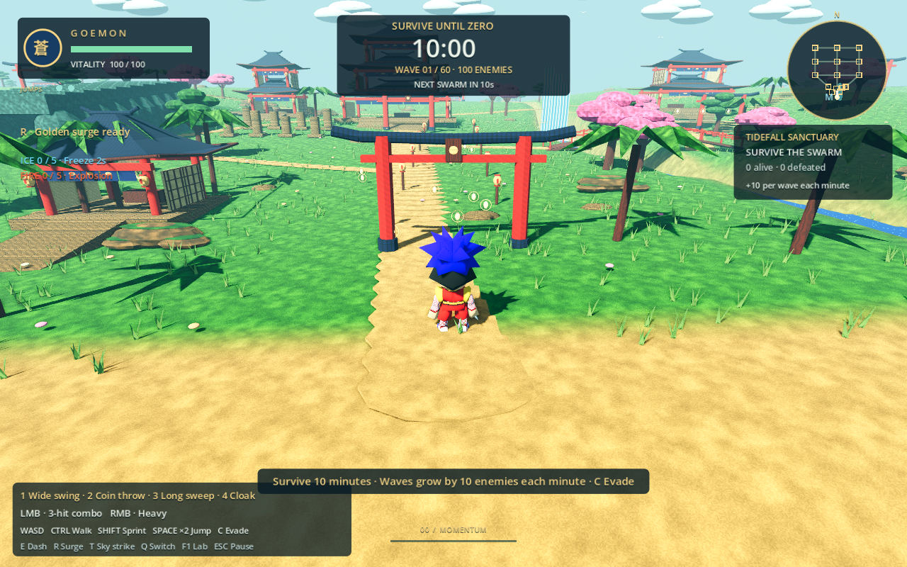
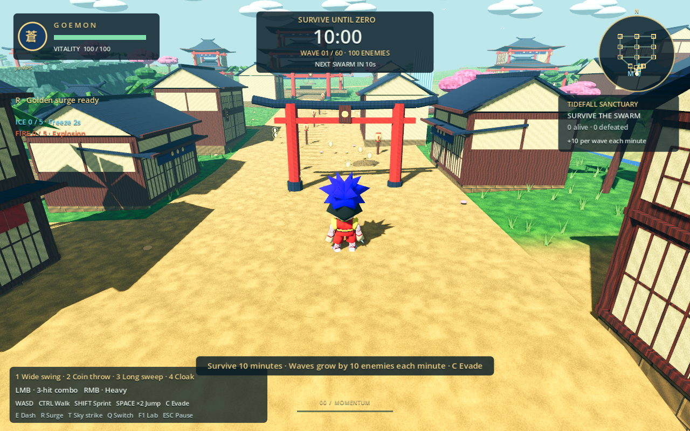
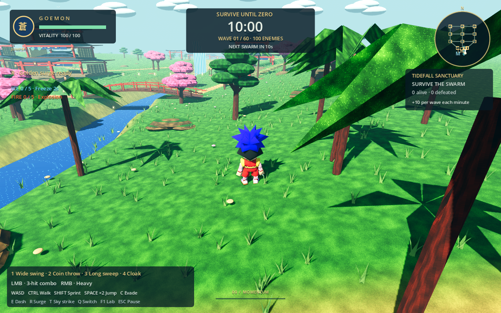
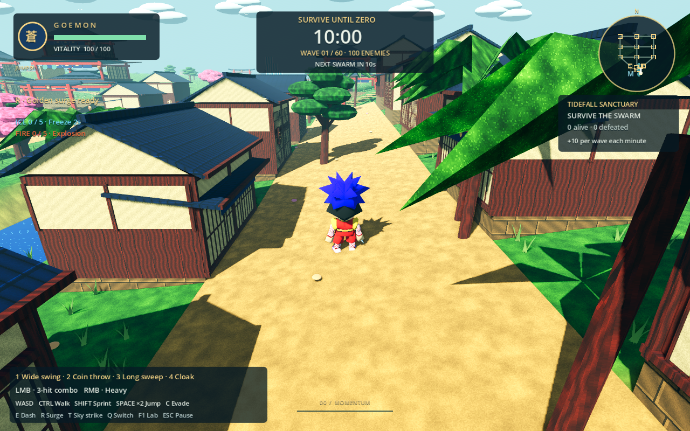
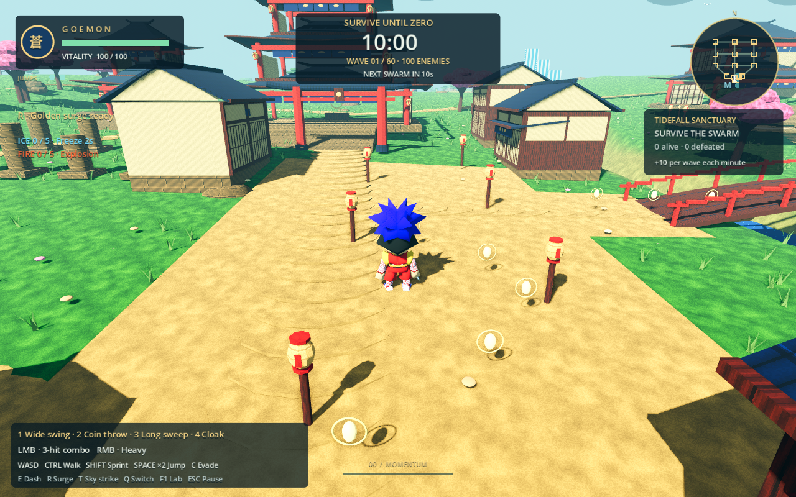
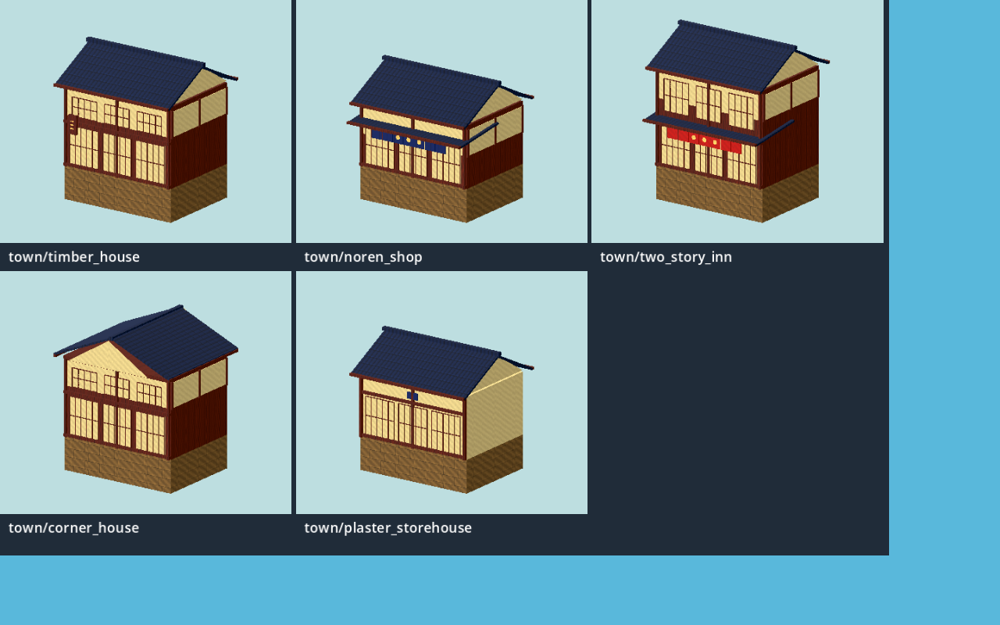

# Tidefall town — original Blender kit

The main area's former lawns now frame a market avenue, setback plaza, waterfront street and western residential frontage. Twenty-four new buildings create aligned roof lines and open cross-passages, closed shoji frontages, blue shop curtains and three taller red-curtain inns. The existing temple anchors the northern view. This pass changes Tidefall only; the three dormant regions retain their previous reskin.

All five variants are original Blender geometry with packed original 128-pixel Edo textures. Primary inspiration is the colorful Edo setting of Mystical Ninja Starring Goemon: [Oedo reference screenshot](https://djcube.co.uk/wp-content/uploads/2023/10/goemon-002.jpg) and [market reference screenshot](https://readonlymemo.com/content/images/size/w1600/2024/08/goemon-3.jpg). The requested [model catalog](https://models.spriters-resource.com/nintendo_64/mysticalninjastarringgoemon/) returned HTTP 403/Cloudflare; its unavailable model geometry was not inspected or downloaded. No ripped models or paid-pack files are included.

## Before and after

Both captures use the same deterministic seed, player position, 63-degree gameplay camera and 14 m follow distance. AI is frozen for comparison; these are actual Godot gameplay renders with the unchanged HUD and hero.

| Previous market approach | New market street |
| --- | --- |
|  |  |

| Previous entrance | New entrance |
| --- | --- |
|  |  |

| Previous waterfront | New waterfront |
| --- | --- |
|  |  |



## Asset names for feedback



| Stable asset ID | Description | Instances |
| --- | --- | ---: |
| `town/timber_house` | Two levels of shoji and vertical timber sign | 6 |
| `town/noren_shop` | Low shop, lean-to eave, blue split curtain and circle crest | 6 |
| `town/two_story_inn` | Taller facade, lower lean-to and red curtain | 3 |
| `town/corner_house` | Perpendicular gable roof for block ends | 4 |
| `town/plaster_storehouse` | Broad cream-plaster walls and blue facade emblem | 5 |

[Machine-readable catalog](asset-catalog.json) records source/export paths, SHA-256 hashes, thumbnail paths and every use. [Placement map](placements.json) records the 24 stable `tidefall-building-01` through `-24` instance IDs, world XYZ positions and yaw. These names also appear in Godot's scene tree. For example, request “change town/noren_shop” for the variant, or “tidefall-building-04” for one placed building.

Sources: `assets/blender/town/*.blend`; exports: `assets/models/town/*.glb`. Edit a saved Blender source and use `tools/export_blender.py` for that single file. `tools/build_tidefall_town.py` is the original authoring recipe and refuses to replace existing sources without explicit `--replace`. Do not run broad legacy character regeneration. After edits, rerun the placement checks and `python tools/catalog_tidefall_town.py` to update hashes/use mapping.

## Gameplay boundaries and validation

The town adds 24 filled building hulls and 24 matching roof collision meshes (48 new shapes). Closed frontages cannot be walked through, roofs stop jumps/camera probes, and filled interiors reject enemy spawn placement. These new footprints deliberately occupy formerly open ground; local cover and movement around those footprints change. The existing 712 collision shapes remain exact. This is not a claim that the complete collision map is unchanged.

All 11 established route corridors plus player clearance remain clear. All three established combat courts remain open. Six market/plaza/waterfront navigation destinations connect through the existing pursuit field. Five principal views retain the normal 14 m camera distance. Terrain height samples (8,343), map bounds, outposts and seeded RNG state match the prior published build. The three dormant regions match their prior complete audit records.

The final layout relocates the plaza-side inn to the western residential entrance, staggers waterfront buildings and opens 7 m cross-passages between frontage bays. The [full navigation comparison](reachability.json) samples seven complete pursuit fields: all 49 principal destination pairs retain exact baseline route distances, no walkable navigation cell becomes isolated, and all 700 baseline plus 700 final sampled enemy spawns connect to the hero. Reachable grid cells change from 11,828 to 11,798; the 30 removed cells all overlap new solid building clearance. Local routes around new footprints can increase by up to 10 m. The 90 m detour and two isolated pockets found in the rejected layout are gone. These checks preserve established approaches, rather than claiming that new solid buildings have no effect on local cover. Characters, enemies, animation sources, UI, camera logic, stats and combat code are untouched.

Validated with Godot 4.6.3 and Blender 4.3.2:

- Editor import/startup succeeds.
- Town placement/collision/navigation/camera checks: 13 passed; extended baseline reachability/spawn comparisons: 5 passed.
- Survival: 27 passed; direct attacks: 28 passed; elemental orbs: 27 passed.
- All five saved Blender files pass mesh, unit-scale, UV, material and packed-texture checks.
- Seven before/after gameplay views and five asset thumbnails rendered using OpenGL Compatibility on Mesa software rendering.

The Mesa capture run retains the two texture-leak messages already observed at baseline shutdown; no new script errors occurred in the final sequential capture.

Not validated: native Metal/Forward+ rendering, a rebuilt macOS app, or worst-case 8,700-enemy performance. New buildings add cover; the automated route checks do not exhaust every possible camera orbit or combat position.

## Reproduce

From the repository root (with a graphical display for captures):

```sh
python tests/tidefall-town/prepare_before.py
godot --headless --path . --script res://tests/tidefall-town/checks.gd
godot --headless --path . --script res://tests/tidefall-town/reachability.gd
godot --path . --rendering-method gl_compatibility --script res://tests/tidefall-town/review.gd -- --before
godot --path . --rendering-method gl_compatibility --script res://tests/tidefall-town/review.gd
godot --path . --rendering-method gl_compatibility --script res://tests/tidefall-town/kit_review.gd
blender --background --python tests/tidefall-town/audit_blender.py
python tools/catalog_tidefall_town.py
```

The comparison helper retrieves the previous published `_ready` implementation from commit `79d4535` into an ignored test directory; it never edits production code. The checked-in before-audit fixture records that prior build for invariant checks. Run graphical capture commands sequentially so they do not compete for mouse capture.
